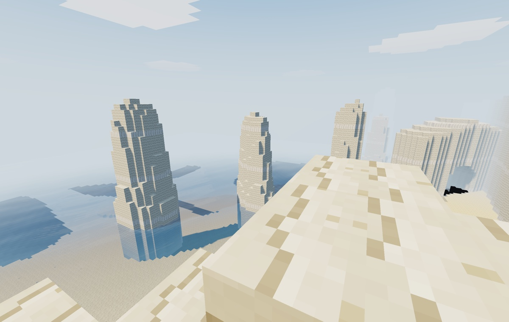
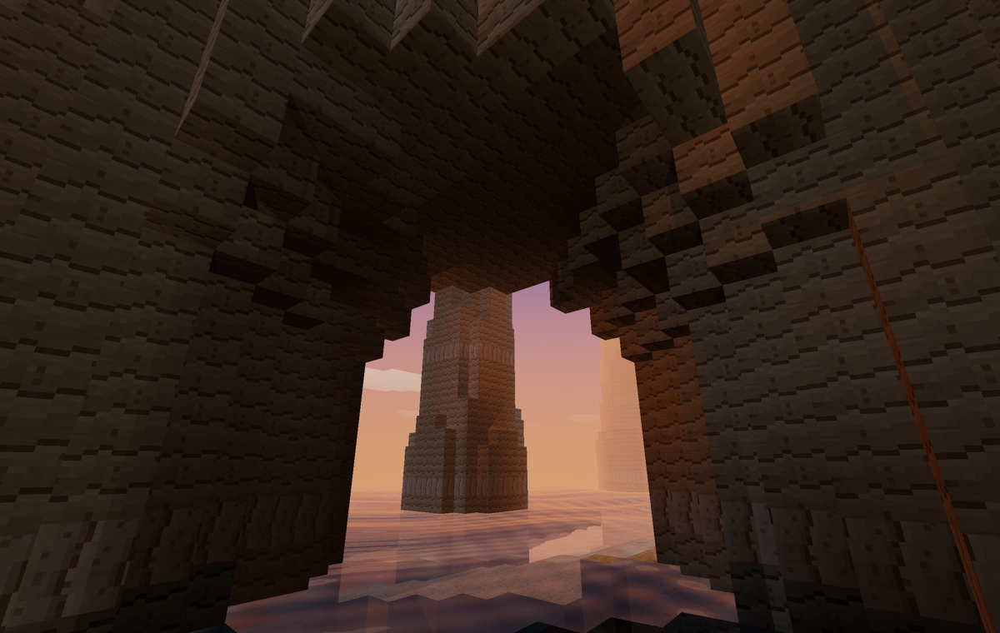
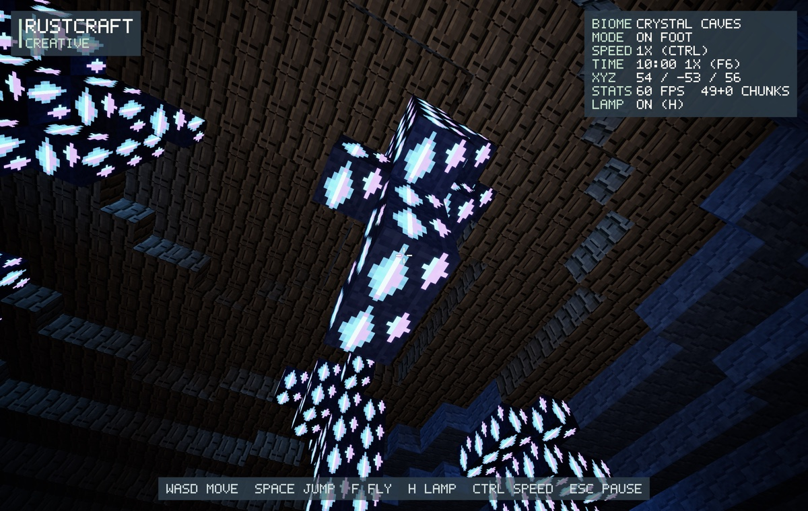
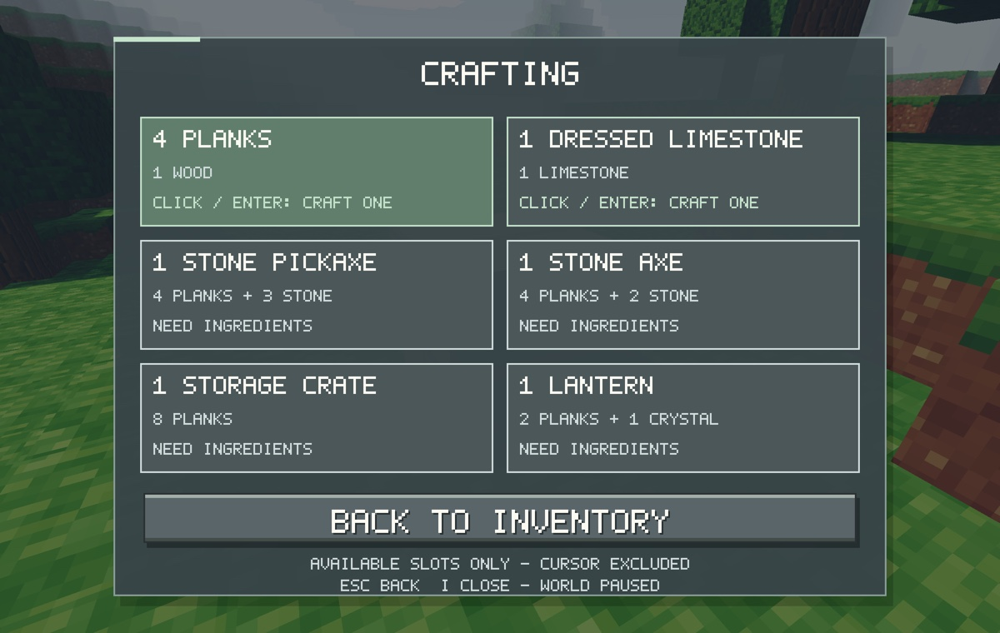

# RustCraft

A peaceful, Minecraft-inspired voxel sandbox written in **Rust**, using **wgpu + winit**. A personal hobby project, **macOS-first** and actively in development.

## Screenshots

| Limestone coast | Sunset through a coastal arch |
| --- | --- |
|  |  |

| Crystal caves | Survival crafting |
| --- | --- |
|  |  |

Actual GPU readbacks from the current renderer, resized for this page. Captured in offscreen smoke tests; the crafting view uses a diagnostic inventory.

## Playable today

- **Explore:** seeded plains, forests, deserts, snowy mountains, limestone cliffs, sea stacks, coves, and arches. Walk, jump, swim with currents, or fly in Creative; flying inside rock reveals a geological cutaway.
- **Go underground:** caves down to **Y=-64**, with galleries, rifts, pillars, lush/crystal biomes, ore veins, pools, and lava.
- **Build in Survival:** mine and collect blocks, manage inventory, place blocks, and craft six recipes: planks, dressed limestone, stone pickaxe/axe, storage crates, and lanterns. Tools are permanent; crates hold 18 stacks.
- **Watch the light change:** a **20-minute day–night cycle**, moving sun shadows, bounced light, volumetric shafts, HDR tone mapping/bloom, and animated water reflections. Headlamp, lanterns, lava, and crystals provide local light.
- **Hear the world:** original footsteps, gathering sounds, wind, surf, freshwater, cave ambience, and underwater filtering. Mute and volume controls live under **Pause → Audio**.
- **Keep your progress:** one local save slot, autosave every 60 seconds, and **Continue** across launches. Terrain edits, inventory, crates, dropped items, player settings, and solar time persist.

No combat, health, hunger, tool durability, drowning damage, multiplayer, or weather. Waterways have generated currents and visual waves, not runtime water spreading; lava is non-damaging scenery. Creative is exploration-only, not block-building.

## Run

Install [rustup](https://rustup.rs/) and, on macOS, the Xcode Command Line Tools (`xcode-select --install`). The repository pins **Rust 1.99.1**; rustup installs it on first use.

```sh
cargo run --release --locked
# Optional seed and chunk radius (default 8, allowed 2–12):
cargo run --release --locked -- --seed 42 --render-distance 6
cargo run --locked -- --help
```

Choose **New Creative**, **New Survival**, or **Continue** from the menu. Click to capture the mouse; **Esc** pauses and releases it. Starting a new world asks before replacing an occupied save.

## Controls

| Input | Action |
| --- | --- |
| WASD / Mouse | Move / look |
| Space / Shift | Jump; ascend / descend in water or flight |
| F or double-tap Space | Toggle Creative flight |
| Ctrl (tap) | Cycle Creative movement speed, 1×–16× |
| H | Toggle headlamp |
| R / F11 | Return to safe spawn / fullscreen |
| Hold left-click / right-click | Mine / place in Survival; right-click a crate to open it |
| 1–9 or wheel | Select hotbar slot |
| I / C in inventory | Inventory / crafting |
| Left / right-click a slot | Move a stack / split or place one item |
| Esc | Pause or close an overlay |
| Slash or backtick / F6 | Time debug console / cycle solar speed presets |

### Quick lighting demo

Open the console with **Slash** or **backtick**. It starts with `/time ` entered; type `speed 60` and press Enter for a complete cycle in **20 seconds**.

| Command | Effect |
| --- | --- |
| `/time speed 60` | Accelerate solar time only |
| `/time speed 1` / `/time speed 0` | Normal cycle / freeze the lighting phase |
| `/time set dawn` / `/time set sunset` / `/time set night` | Jump to a lighting showcase phase |
| `/time set 17:30` | Set an exact clock time |

**H** compares natural night/cave lighting with the headlamp. Time pauses with gameplay; acceleration never speeds up physics, mining, or animations and is not saved. Launch with `--time-speed 60` for the same demo; `--time-of-day sunset` sets previews/new worlds without overwriting Continue's saved phase.

## Saves

On macOS: `~/Library/Application Support/RustCraft/world.save`. Other platforms use their per-user application-data directory; the terminal prints the path. Back up this file while the game is closed. Saves use atomic replacement; leaving via Main Menu, Quit, or window close also saves.

Current format: **4**, terrain generation: **2**. Format-3 saves remain loadable and start at 10:00. Other incompatible saves require an explicitly confirmed new world—never an automatic reset.

## Development

One Cargo package, with renderer-independent world/gameplay logic and native GPU adapters. Local checks:

```sh
cargo fmt --all -- --check
cargo clippy --all-targets --locked -- -D warnings
cargo test --locked
cargo run --locked -- --smoke-test
```

Add `--screenshot /existing/directory/frame.png` to capture GPU frames. On a locked/asleep display, use `--offscreen-smoke-test`; it checks rendering, **not native presentation or physical input**. Smoke tests are silent and never touch the player's save. `--no-audio` disables interactive playback.

More detail: [architecture](docs/architecture.md) · [lighting](docs/lighting.md) · [world generation](docs/world-generation.md) · [water](docs/water-worlds.md) · [roadmap and playtest status](docs/roadmap/README.md).

## License

[MIT](LICENSE) © 2026 Ben Theunissen. Not affiliated with Mojang, Microsoft, or Airwallex.
